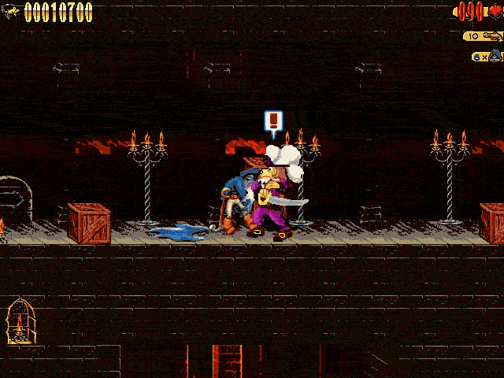
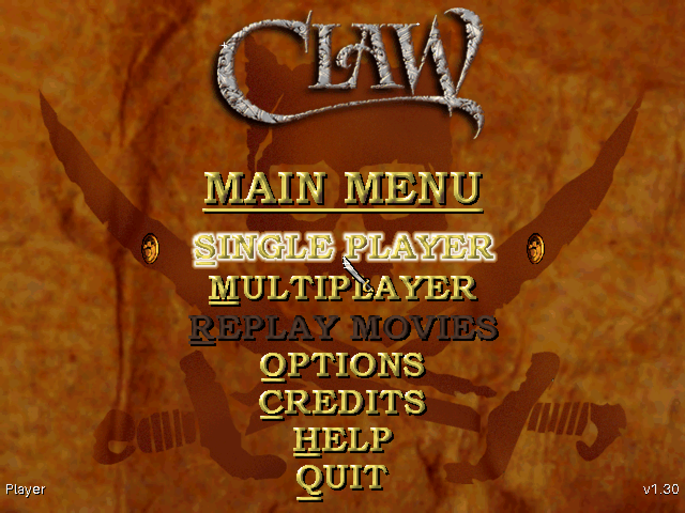
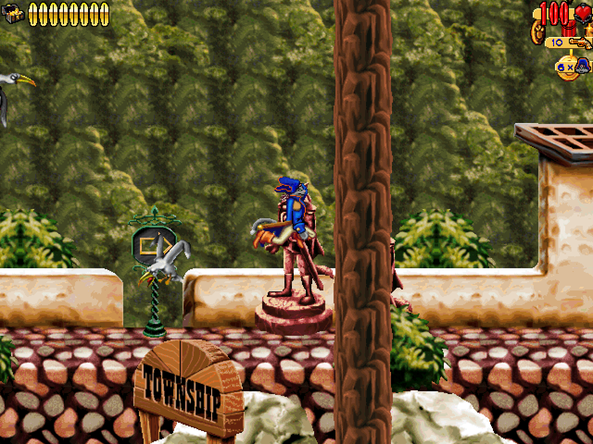
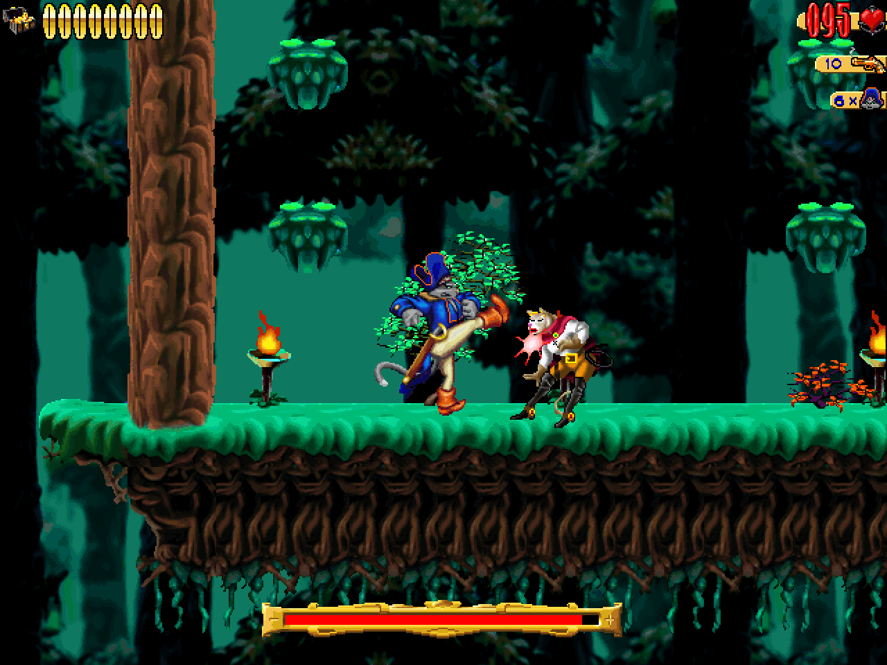
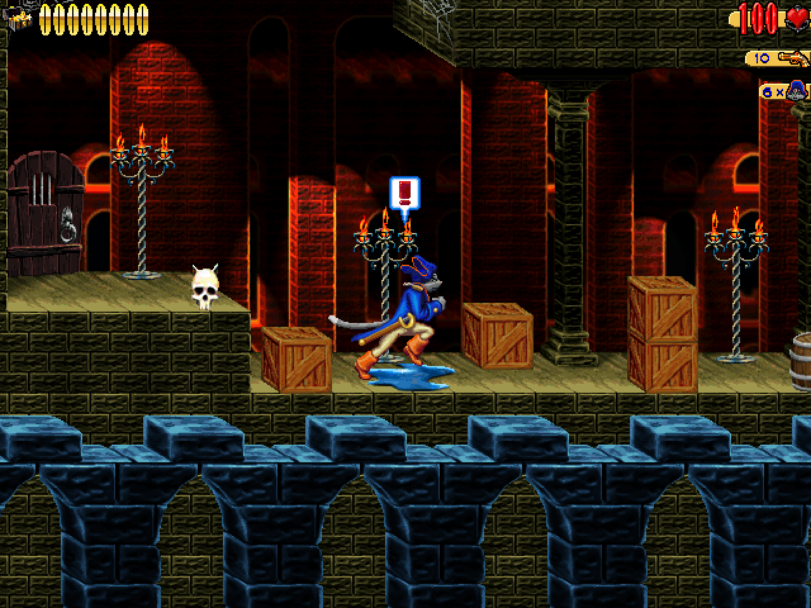
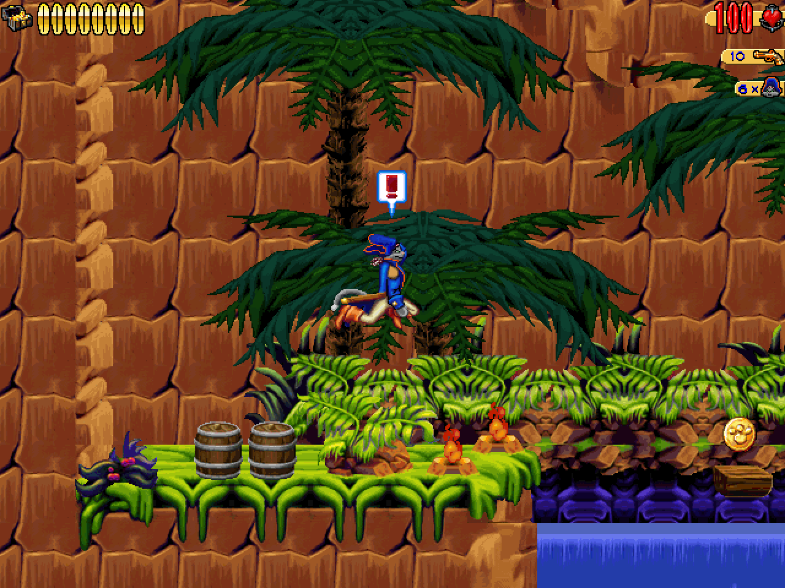
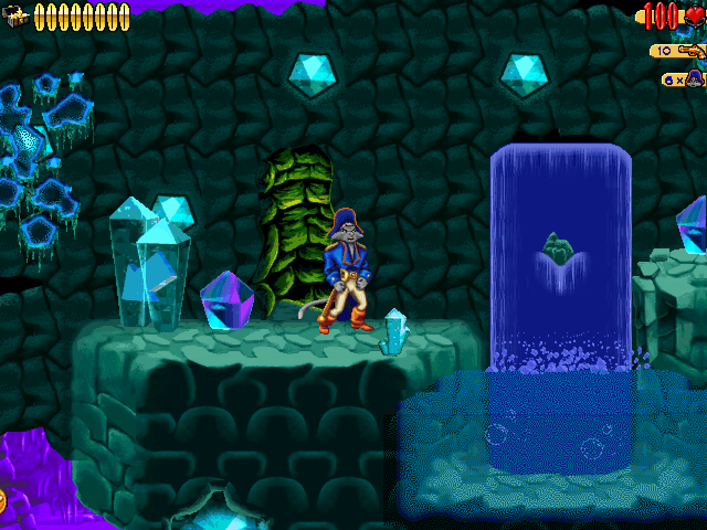
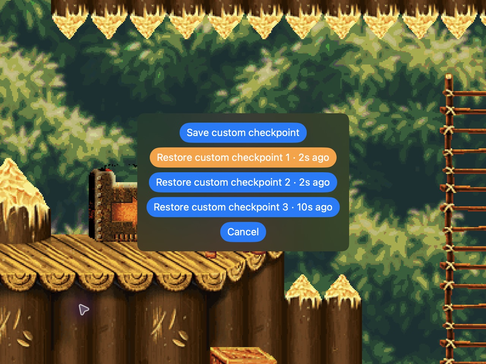

# Captain Claw, native on iPad and Mac

Monolith's 1997 platformer **Claw**, running natively on iPad and Mac. It plays like the original: the same levels, the same enemies and the same physics, frame for frame. It is not an emulator, and no Windows code runs inside the app.



<p>
  
  
  
  
</p>

## What you get

- **The whole single-player game.** All 14 levels, the bosses, the cutscenes and the music, with the gameplay changes from the v1.3 release.
- **Custom levels from [The Claw Recluse](https://captainclaw.net).** Load them through the original *Single Player → Load Custom Level*. *Import…* brings a level in, from the Files app on iPad.
- **CrazyHook levels.** Levels made for the community's [CrazyHook](https://captainclaw.net/en/downloads.html) update work too, including their physics settings, palettes, Lua scripts and save points. Levels that need Windows plugin DLLs show a clear "unsupported" message instead.
- **A custom checkpoint with three slots.** Save anywhere and come back to exactly that moment, with your stats, treasure, switches and elevators as they were. Each level keeps your last three saves.
- **Keyboard and game controller.** Use the original key layout, which you can remap, or any controller that iPadOS and macOS support.
- **Mac too.** The same app runs on Apple Silicon and Intel Macs (Mac Catalyst).

<p>
  
  
</p>

## What you need

**No game files are included in this repository.** Claw belongs to Monolith Productions and Takarajimasha, and nobody sells it any more. Fan sites have kept it available for decades, and this project includes a script, `scripts/get-game-data.py`, that fetches the game from them and prepares it on your machine. If you own the original 1997 disc, you can use your own files instead.

The script supports these sources:

| Source | How | What you get |
| --- | --- | --- |
| **Original CD from [MyAbandonware](https://www.myabandonware.com/game/claw-a39)** (default) | `python3 scripts/get-game-data.py` | The exact original game: the disc's levels and graphics, the original music and the cutscenes. One direct download of about 520 MB. |
| **Your own disc** | `--source /path/to/CLAW.REZ` (or a folder, ISO or MDF image) | The exact original game. Add `MOVIES/CLAW.FEC` for cutscenes and `MUSIC/CLAW4.SF2` for the original music instruments. |
| **[The Claw Recluse](https://captainclaw.net/en/downloads.html) "CrazyHook" package** | `--package crazyhook` | The fan community's free 70 MB package. Everything plays, with two small differences from the disc made by the CrazyHook team: Level 9 has one fewer crate and one fewer seagull, and Level 14 has one fewer Tiger Guard. It has no music instrument file, so music uses Apple's built-in instruments on Mac and is silent on iPad, unless you add `--soundfont` with your own `CLAW4.SF2`. `--cutscenes` tries to fetch the cutscene file The Claw Recluse links to. |
| **The Claw Recluse DVD torrent** | automatic fallback if the CD download fails and [aria2](https://aria2.github.io) is installed (`brew install aria2`) | The 1.3 GB "DVD Version with Extras" image, used like the CD. |

If the CD download is unavailable and there's no aria2, the script falls back to the CrazyHook package. Every download happens once, is checked against a known hash, and is kept in `~/Library/Caches/claw-ipad`. The script prints where the files came from, and never uploads or mirrors anything.

You also need:

- A Mac with a recent **Xcode** (this was built with Xcode 27), and **Python 3** (the one that comes with macOS works).
- For iPad: an iPad on **iPadOS 17 or later** (developed on a 13-inch iPad Pro M5) and an Apple ID to sign the app in Xcode. A free Apple ID works, but the app then stops opening after 7 days until you install it again.
- **ffmpeg** (`brew install ffmpeg`) to convert the cutscenes. Without it, setup works but skips them.
- Optional: **Pillow** (`pip3 install pillow`) to draw the app icon from the game's art. Without it you get a plain compass icon.

## Play it yourself

1. **Get the code.**

   ```sh
   git clone https://github.com/Adrxx/claw-native.git
   cd claw-native
   ```

2. **Get the game data.**

   ```sh
   python3 scripts/get-game-data.py                            # original CD (default)
   python3 scripts/get-game-data.py --source /path/to/CLAW.REZ  # or your own disc
   python3 scripts/get-game-data.py --package crazyhook        # or The Claw Recluse package
   ```

   This creates `App/GameData`, which is ignored by git and stays on your machine.

3. **Build and run.** Open `Claw.xcodeproj` in Xcode and pick the **Claw** scheme. Before signing for iPad, create `Local.xcconfig` in the repository root (ignored by git) with your own unique identifier and signing team:

   ```xcconfig
   CLAW_BUNDLE_IDENTIFIER = com.yourname.claw
   DEVELOPMENT_TEAM = YOUR_TEAM_ID
   ```

   The shared default is `org.claw.reconstruction`. `Claw.xcconfig` loads your optional local override for both Debug and Release; keep it private.
   - **Mac:** choose *My Mac (Mac Catalyst)* and press Run.
   - **iPad:** connect the iPad, choose it as the destination, set your team under *Signing & Capabilities*, and press Run. The first time, allow the developer certificate on the iPad under *Settings → General → VPN & Device Management*.

## Controls

- **Keyboard:** the original defaults, remappable in *Options → Controls*. On iPad, use any hardware keyboard.
- **Game controller:** works in the menus and in play, and is remappable.
- **Touch controls (iPad):** a semi-transparent on-screen pad and buttons, off by default. Turn them on in *Options → Controls → On-screen touch controls*. Claw needs quick, precise and often simultaneous presses, so a keyboard or game controller plays much better; the touch controls are there for when you have neither.
- **Custom checkpoint:**
  - **iPad:** tap with three fingers to open the checkpoint panel. It has *Save custom checkpoint* and the three saved slots, newest first, each showing how long ago it was saved.
  - **Mac:** Command+3 saves, Command+Shift+3 restores the newest, and Command+Option+Shift+3 opens the slot chooser.
  - Restoring works from the pause menu too.

  
 Saving puts the new save in the newest slot and drops the oldest one when all three are full. The custom checkpoint never touches your normal saves.

## Custom levels

Download levels from [The Claw Recluse custom levels page](https://captainclaw.net/en/clevels.html). Then, from *Single Player → Load Custom Level*, tap *Import…* and choose the level's `.wwd` file, or the folder holding it and its same-name asset folder. On iPad that opens the Files app (iCloud Drive, On My iPad, etc.).

CrazyHook levels need nothing extra: the few CrazyHook helper files they rely on ship in [`App/CrazyHookHelpers/`](App/CrazyHookHelpers/README.md), credited to their authors.

## How it works

Claw was a 32-bit Windows program. The game logic is recovered from the original v1.0 `CLAW.EXE` one group of functions at a time, and rewritten as native C++. Each group ("family") is then verified against the original. The same inputs run through the native code and through the original machine instructions under emulation, and both must make the same calls, write the same memory and return the same values. An automatic admission gate decides what counts as verified. It also checks that its tests would catch small deliberate mistakes in the code.

Only game code is recovered. Everything the original got from Windows (windowing, DirectX drawing and sound, input, files, timers, the C runtime and MFC) is replaced by native Swift code using Apple's frameworks (SwiftUI, AVFoundation, GameController). The game still draws its original 640×480 picture, which the app scales to the screen.

A few numbers:

- 514 recovered families, 419 of them admitted by the gate ([docs/STATUS.md](docs/STATUS.md)).
- Each of the 14 retail levels has a play check against recorded runs of the original, and level transitions, boss fights and the v1.3 changes are checked too.

### What is in this repository, and what is not

| Tracked | Not tracked (stays on your machine) |
| --- | --- |
| The recovered game code and the native platform layer (`Sources/`, `App/`) | The game EXE and `CLAW.REZ` |
| Data tables the build used to read from `CLAW.EXE`: menu text, key bindings, program constants and level tables ([`App/OriginalTables/`](App/OriginalTables/README.md)) | Everything extracted from your `CLAW.REZ`: levels, graphics, sounds |
| The CrazyHook helper files ([`App/CrazyHookHelpers/`](App/CrazyHookHelpers/README.md)) | The cutscenes and music |
| Tests and tooling (`Tests/`, `scripts/`, `tools/`) | `App/GameData/` and the working folder `work/` |
| Screenshots and clips for this page (`docs/media/`) | |

## Credits

- **Claw** © 1997 Monolith Productions and Takarajimasha. This is a fan project with no affiliation to them. Please keep supporting the original.
- **[The Claw Recluse](https://captainclaw.net)** and its community, for keeping Claw alive for decades, and for the custom levels and the CrazyHook package.
- **[MyAbandonware](https://www.myabandonware.com)**, for keeping the original CD available.
- **CrazyHook** by Zax37 and Cubuspl42 for The Claw Recluse community, revised by TSXD.
- Reconstruction by [Adrxx](https://github.com/Adrxx), with Claude (Anthropic) and Codex (OpenAI) doing most of the recovery and verification work.

## For contributors

Development rules and the workflow are in [CLAUDE.md](CLAUDE.md) and [docs/OPERATING.md](docs/OPERATING.md), and every command is listed by `make help`. The verification tooling needs the original EXE and the hash-pinned files listed in [AGENTS.md](AGENTS.md). Playing needs only `CLAW.REZ`.

## License

The project's own code is released under the GNU GPL v3; see [LICENSE.txt](LICENSE.txt). The original game and its assets remain the property of their owners and are not included.
